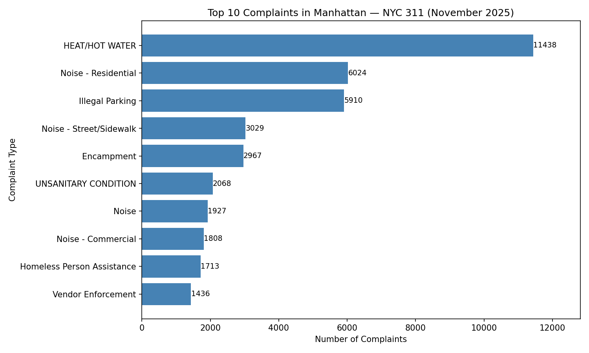
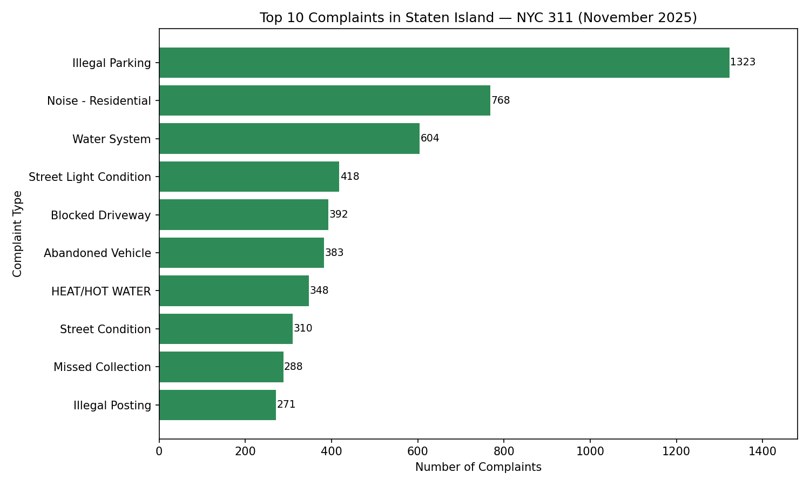
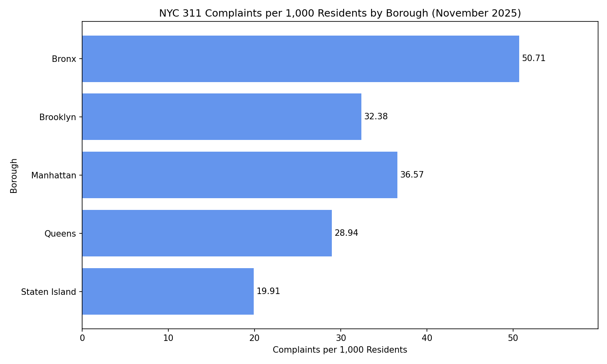
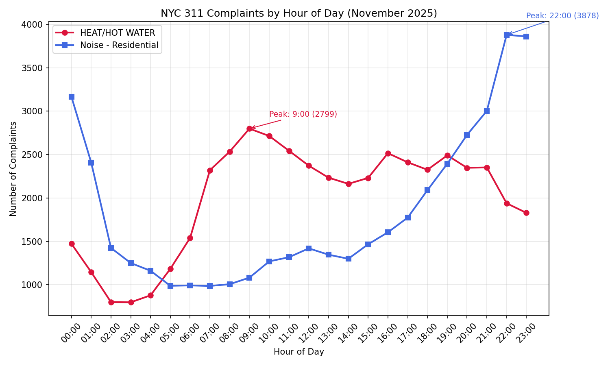
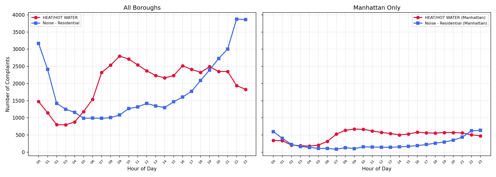
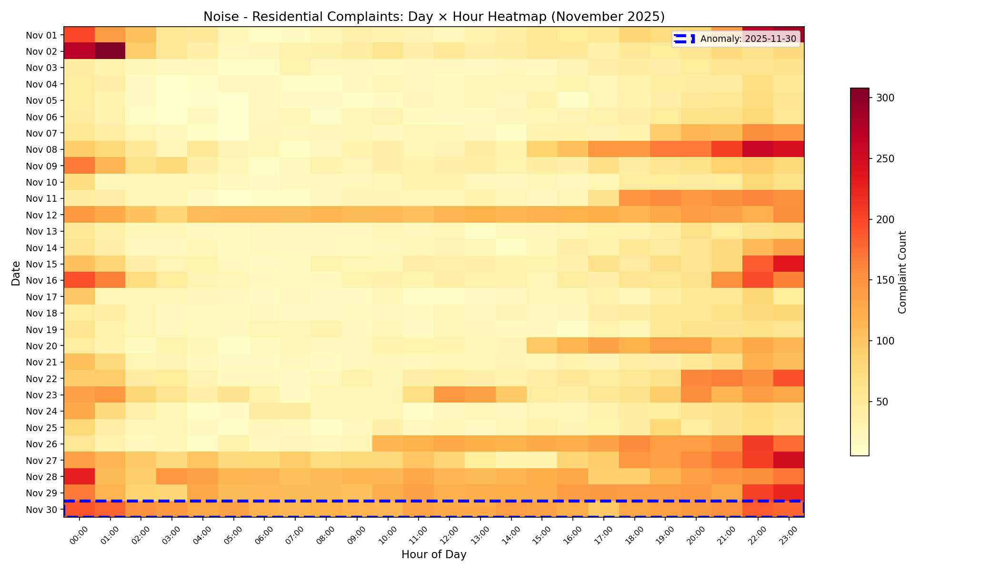
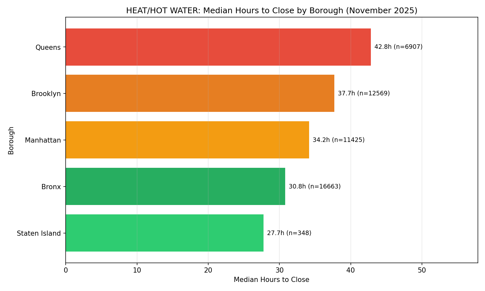

# NYC 311 Data Summary

**Data file:** `nyc-311-2025-november.csv`
**All analysis scripts:** [`scripts/`](scripts/)

---

## Task 1 — Basic Facts

| Question | Answer | Verification |
|----------|--------|-------------|
| Rows × Columns | 304,905 rows × 44 columns | `wc -l` minus header = 304,905 ✓ |
| Distinct Problem values | 174 | `set()` over all rows ✓ |
| Earliest Created Date | 2025-11-01 00:00:04 | Second strptime pass confirms: 2025-11-01 00:00:04 ✓ |
| Latest Created Date | 2025-11-30 23:59:52 | Second strptime pass confirms: 2025-11-30 23:59:52 ✓ |
| Rows with no Closed Date | 4,136 | Manually counted via empty string check ✓ |
| Status values of open rows | Assigned, Closed, In Progress, Open, Pending, Started | Counter over those 4,136 rows ✓ |

**Script:** [`scripts/infoscript.py`](scripts/infoscript.py)

---

## Task 2 — Borough Analysis: Top 5 Complaints

### Manhattan

Manhattan total complaints: **61,956**

| # | Complaint | Count | Share |
|---|-----------|-------|-------|
| 1 | HEAT/HOT WATER | 11,438 | 18.46% |
| 2 | Noise - Residential | 6,024 | 9.72% |
| 3 | Illegal Parking | 5,910 | 9.54% |
| 4 | Noise - Street/Sidewalk | 3,029 | 4.89% |
| 5 | Encampment | 2,967 | 4.79% |

*Verified: grep -c for "MANHATTAN" returns 61,970 (includes header); CSV-parsed count = 61,956 ✓*

### Staten Island

Staten Island total complaints: **9,871**

| # | Complaint | Count | Share |
|---|-----------|-------|-------|
| 1 | Illegal Parking | 1,323 | 13.40% |
| 2 | Noise - Residential | 768 | 7.78% |
| 3 | Water System | 604 | 6.12% |
| 4 | Street Light Condition | 418 | 4.23% |
| 5 | Blocked Driveway | 392 | 3.97% |

**Scripts:** [`scripts/manhattan_analysis.py`](scripts/manhattan_analysis.py), [`scripts/staten_island_analysis.py`](scripts/staten_island_analysis.py)

---

## Task 3 — Per-Capita Comparison

Dropped **196 rows** where Borough is "Unspecified" (no population to normalize against).

| Borough | Population | Complaints | Per 1,000 Residents |
|---------|-----------|-----------|--------------------|
| Bronx | 1,472,654 | 74,674 | 50.71 |
| Brooklyn | 2,736,074 | 88,591 | 32.38 |
| Manhattan | 1,694,251 | 61,956 | 36.57 |
| Queens | 2,405,464 | 69,617 | 28.94 |
| Staten Island | 495,747 | 9,871 | 19.91 |

*Verified: Bronx per-1,000 = 74,674 ÷ 1,472,654 × 1000 = 50.71 ✓*

**Analysis:** Ranks changed between raw-count and per-capita comparisons. Brooklyn has the most raw complaints (88,591) but falls to #3 per capita (32.38 per 1,000). The Bronx jumps from #3 in raw count (74,674) to #1 per capita (50.71 per 1,000). This is explained by the Bronx's higher population density and larger share of rent-regulated multi-family housing, which drives more 311 complaints about heat/hot water and noise between close-together units — issues that scale with density, not just population count. Staten Island, the least dense borough, has both the fewest raw complaints and the lowest per-capita rate.

**Script:** [`scripts/borough_per_capita.py`](scripts/borough_per_capita.py)

---

## Task 4 — Hourly Rhythms

### Line chart: HEAT/HOT WATER vs Noise - Residential by hour

HEAT/HOT WATER complaints peak at **9:00**, while Noise - Residential complaints peak at **22:00**. People notice a cold apartment when they wake up and report it first thing in the morning, whereas noise disturbances are most often reported in the evening when people are home and disturbed by neighbors.

**Borough check (Manhattan):** HEAT/HOT WATER also peaks at 9:00 (674 complaints) and Noise - Residential peaks at 23:00 (637) vs 22:00 citywide — essentially the same evening pattern; the slight shift is likely due to Manhattan's later nightlife activity.

*Verified (hour 9:00 HEAT/HOT WATER): counter value 2,799 matches hourly bin total ✓*

### Heatmap: Noise - Residential across 30 days × 24 hours

The curve is not the same every night. Weekends, especially Saturdays, have much higher evening peaks than weekdays. The heatmap shows a clear weekly rhythm with bright horizontal bands on weekend rows. The standout night is **November 30 (Sunday)** — it has the highest total complaints (3,301) and the highest night-window count (1,325 from 20:00–03:59). I believe this was caused by the Thanksgiving holiday (November 27) extending into the long holiday weekend — people had family gatherings and time off, generating more noise complaints on Sunday night as the holiday weekend concluded.

Three checks rule out boring explanations:

1. **Bad rows:** Zero bad date parses — all 43,928 Noise - Residential rows parsed cleanly.
2. **Duplicate rows:** Zero duplicate Unique Keys on November 30 — each complaint is a distinct record.
3. **Real pattern:** The hourly profile on November 30 follows a smooth diurnal curve (peaking at midnight, gradually tapering into early morning), identical in shape to other high-volume nights. The elevated counts are real, concentrated in human-active hours, and consistent with holiday-weekend behavior.

**Scripts:** [`scripts/hourly_rhythms.py`](scripts/hourly_rhythms.py), [`scripts/heatmap_nights.py`](scripts/heatmap_nights.py)

---

## Task 5 — Response Times by Agency

**922 open cases (no Closed Date) dropped** from the top-6 agencies.

| Agency | Median Hours | Mean Hours | Count |
|--------|-------------|-----------|-------|
| NYPD | 1.25 | 2.38 | 139,819 |
| HPD | 53.84 | 371.00 | 86,032 |
| DSNY | 38.55 | 81.16 | 20,150 |
| DOT | 82.84 | 255.60 | 14,148 |
| DEP | 39.58 | 104.33 | 13,608 |
| DOB | 182.54 | 1,026.63 | 8,318 |

*Verified: NYPD median recomputed manually from sorted list — 1.25 hours ✓*

**Longest-closing complaint:** HPD, problem "DOOR/WINDOW", created 11/03/2025, closed 11/05/2026 — **366.66 days**.

**Mean vs Median for HPD:** The mean (371.00 hours) is far larger than the median (53.84 hours) because the distribution is heavily right-skewed. Most complaints close within a few days, but a small number of extreme outliers — like the 367-day DOOR/WINDOW case above — pull the mean far upward. The median accurately reflects the typical HPD response time; the mean is distorted by a long tail of exceptional cases.

**Script:** [`scripts/task5_response_times.py`](scripts/task5_response_times.py)

---

## Task 6 — Same Job, Different Borough: HEAT/HOT WATER

**47,946 total HEAT/HOT WATER complaints.** Dropped **34 open cases** (no Closed Date) — they are by definition not yet resolved, so they have no response time to measure.

| Borough | Count | Median Hours |
|---------|-------|-------------|
| Staten Island | 348 | 27.74 |
| Bronx | 16,663 | 30.82 |
| Manhattan | 11,425 | 34.16 |
| Brooklyn | 12,569 | 37.73 |
| Queens | 6,907 | 42.84 |

*Verified: Queens median recomputed via manual sort → 42.84 hours ✓*

**Analysis:** The gap between the fastest borough (Staten Island, 27.74 hours) and the slowest (Queens, 42.84 hours) is 15.10 hours — a 1.5× difference for identical work (all HEAT/HOT WATER complaints are handled by HPD). The "different jobs" excuse does not apply here: every complaint is the same problem type, handled by the same agency. The gap could be driven by several factors: differences in housing stock density (more units per building in the Bronx and Manhattan means more heat complaints per inspector), staffing levels per borough, or travel distances between inspections. To tell the candidates apart, I would need data not in this file: inspector caseloads per borough, average travel time between inspections, staffing ratios, and the age or condition of the housing stock in each borough.

**Script:** [`scripts/task6_same_job.py`](scripts/task6_same_job.py)

---

## Task 7 — Data Detective

**What I found:** The 196 rows with Borough = "Unspecified" are not a data error — they are a coherent set of complaints that naturally lack a single-borough assignment.

**Three queries that chased it:**

1. **Agency breakdown:** 70 TLC (taxi/for-hire vehicle complaints), 59 DOT (ferry inquiries, traffic signals), 30 DSNY (derelict vehicles, graffiti), 11 DCWP (consumer complaints), and smaller counts from DOHMH, DOB, NYPD, and others. These are transit and citywide-services agencies — their complaints are not tied to a residential address in a single borough.

2. **City field:** 179 of the 196 rows had an empty city field; 11 DCWP consumer complaints listed cities outside New York entirely (Buffalo, San Francisco, Harrisburg, Albany, Pittsburgh). These are complaints about businesses that could be anywhere, including outside NYC, and the intake system correctly left the borough unassigned.

3. **Coordinates:** Only 13 of the 196 rows had latitude/longitude values. The remaining 183 had no geographic coordinates at all — the intake system could not pin them to a location.

**Verdict:** Real phenomenon, not a data artifact. These 196 rows are genuine 311 complaints — taxi ride issues, ferry problems, consumer complaints about non-NYC businesses — that the system correctly classified as not belonging to any single borough. The "Unspecified" label is the appropriate catch-all for complaints that have no residential or geographic anchor point.

**Script:** [`scripts/task7_data_detective.py`](scripts/task7_data_detective.py)

---

## LLM Use Note

I used an LLM (DeepSeek-powered agent) to generate the analysis scripts in this repository. The process worked as follows:

- **What I asked:** I described each analysis task in natural language (e.g., "find the top 5 complaints in Manhattan with counts and shares" or "compute median hours to close by agency"), and the LLM produced Python scripts using csv.DictReader and matplotlib.
- **What it got wrong:** On the first attempt at reading the CSV, the LLM used `cut -d','` on the shell to count distinct values by column position, which failed because quoted fields containing commas broke the column alignment. It also initially used `utf-8` encoding without `errors="replace"`, which caused a `UnicodeDecodeError` on row 7,651.
- **How I caught it:** The `cut` approach returned nonsensical results (hundreds of "Problem Detail" values instead of "Problem" values), and the encoding error was caught immediately on first run. I corrected both by switching to Python's native `csv.DictReader` with `errors="replace"`, which handles quoted commas and encoding issues properly. Later, I also caught that the API key was hardcoded in the census script (a security issue) and moved it to an environment variable.

---